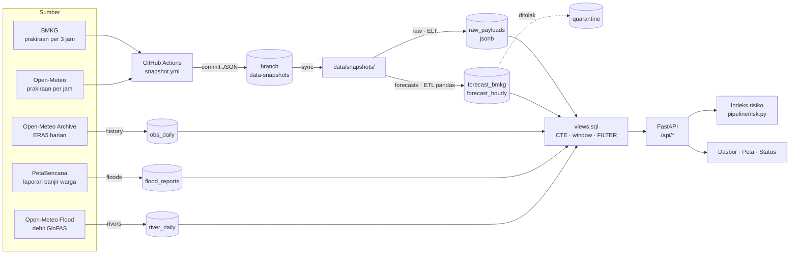
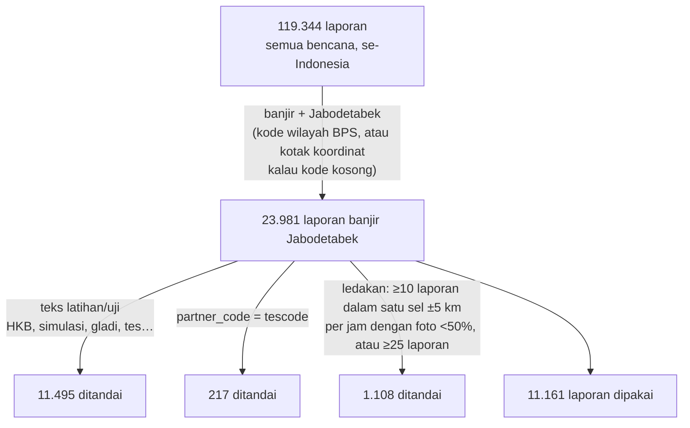

# 🔁 Perjalanan Data SIAGA NUSA

> Asal dan alasan setiap ambang, bobot, dan batas angka dikumpulkan terpisah di [`dasar-angka.md`](dasar-angka.md).

Dokumen ini menelusuri perjalanan satu angka, dari respons mentah API BMKG atau Open-Meteo sampai muncul di dasbor sebagai *"Jakarta diprakirakan hujan ringan mulai pukul 12.00"*. Semua angka di sini berasal dari eksekusi nyata pipeline pada **23 November 2026**.

**Prinsip yang dipegang di setiap tahap:**

1. **Data mentah tidak pernah diubah atau dibuang.** Pembersihan selalu dikerjakan pada salinannya.
2. **Nilai kosong dibiarkan kosong.** Angka hujan tidak pernah diisi tebakan, karena angka karangan di aplikasi cuaca dan banjir bisa menyesatkan orang.
3. **Baris yang ditolak disimpan beserta alasannya** di tabel karantina, tidak dihapus diam-diam.
4. **Setiap job aman dijalankan berulang (idempotent).** Menjalankan ulang tidak membuat baris ganda.
5. **Setiap angka membawa sumber dan waktunya** sampai ke layar.

---

## 🗺️ Gambaran besar



Pipeline dijalankan dengan satu perintah, `python -m pipeline.run all`, yang mengeksekusi job berurutan: `init → sync → raw → forecasts → history → floods → rivers → views`.

---

## 1. Sumber data

| Sumber | Isi | Frekuensi | Kenapa dipakai | Label di UI |
|---|---|---|---|---|
| **BMKG** `api.bmkg.go.id/publik/prakiraan-cuaca` | Prakiraan resmi per kelurahan, blok 3 jam, 3 hari ke depan | Terbit ±2× sehari | Satu-satunya sumber **resmi** | 🟢 Resmi |
| **Open-Meteo Forecast** | Prakiraan per jam, 7 hari: hujan, peluang hujan, suhu, kelembapan, angin, awan | Diperbarui per jam | Resolusi jam, dipakai untuk grafik dan peta | 🔵 Data model cuaca |
| **Open-Meteo Archive (ERA5)** | Hujan harian historis sejak 2017 | Harian, tertinggal ±5 hari | Akumulasi hujan dan label Model A | 🔵 Data model cuaca |
| **PetaBencana.id** | Laporan banjir warga (titik koordinat) | Realtime | Bukti kejadian banjir di lapangan | 🟡 Laporan warga |
| **Open-Meteo Flood (GloFAS v4)** | Debit sungai harian sejak 1984 + prakiraan 30 hari, grid 0,05° | Harian | Komponen debit di indeks risiko | 🔵 Data model cuaca |

Lokasi pilot ada 8 kota, dengan titik koordinat diambil dari kelurahan BMKG supaya BMKG dan Open-Meteo merujuk ke titik yang sama ([`pipeline/locations.py`](../pipeline/locations.py)). Makassar memakai **WITA**, kota lain WIB.

---

## 2. Extract: mengumpulkan data

### 2.1 Kenapa harus mengumpulkan sendiri

BMKG **tidak menyediakan arsip prakiraan**. Prakiraan yang terbit pagi ini akan hilang ketika prakiraan sore terbit. Padahal SIAGA NUSA perlu menjawab *"apa yang berubah sejak pembaruan sebelumnya?"*, dan nanti melatih model dari prakiraan masa lalu. Karena itu setiap respons disimpan sendiri.

### 2.2 Snapshot oleh GitHub Actions

Workflow [`snapshot.yml`](../.github/workflows/snapshot.yml) memanggil BMKG (8 kota, jeda 1 detik antar-kota) dan Open-Meteo (8 kota dalam satu panggilan), lalu meng-commit hasilnya ke branch terpisah `data-snapshots`. Setiap respons dibungkus dalam *envelope*:

```json
{
  "source": "bmkg",
  "location": "jakarta",
  "fetched_at": "2026-11-23T02:48:51Z",
  "request": {"url": "https://api.bmkg.go.id/publik/prakiraan-cuaca", "params": {"adm4": "31.71.03.1001"}},
  "status": 200,
  "error": null,
  "payload": { "...respons asli, tidak diubah..." }
}
```

- Tata letaknya `snapshots/<sumber>/<tanggal>/<jam>Z/<kota>.json` (UTC). File dibuka dengan mode `"x"`, jadi **tidak pernah bisa ditimpa**.
- Panggilan yang gagal tetap disimpan, lengkap dengan pesan error-nya. Kegagalan juga data: dari situ halaman Status tahu kapan sumber bermasalah.
- **Jadwal vs kenyataan.** Cron sudah diset tiap jam (menit ke-17) sejak 19 Nov, tetapi GitHub sering menunda atau melewati cron. Hasilnya hanya **±3 run per hari**, dengan jeda 5–9 jam. Total ada **51 run** antara 6 dan 23 Nov 2026.

### 2.3 Job `sync`

[`pipeline/sync.py`](../pipeline/sync.py) menjalankan `git fetch origin data-snapshots`, lalu `git archive` mengekstrak folder `snapshots/` ke `data/snapshots/`. Ekstraksi memakai `tarfile` dengan `filter="data"` supaya isi arsip tidak bisa menulis ke luar folder tujuan. Hasil hari ini: **816 file** (408 BMKG + 408 Open-Meteo).

### 2.4 Sumber yang ditarik langsung

| Job | Cara | Catatan |
|---|---|---|
| `history` (ERA5) | Backfill dari file arsip 2017–2026, lalu **menyusul hari yang belum ada** lewat API arsip Open-Meteo | ERA5 tertinggal ±5 hari, sehingga API mengembalikan `null` untuk hari terbaru. Hari itu **dibuang, bukan disimpan kosong**: kalau baris kosong sudah tersimpan, `ON CONFLICT DO NOTHING` akan menghalangi angka aslinya masuk nanti |
| `floods` (PetaBencana) | Arsip **bulan lalu dan bulan ini ditarik ulang** setiap eksekusi, lalu semua arsip lokal dimuat | Laporan yang datang terlambat ikut masuk |
| `archive` (Previous Runs) | Prakiraan yang terbit **sehari sebelumnya** (`*_previous_day1`) dari 4 model (best_match, ECMWF, GFS, ICON), ditarik per model per tahun sejak Feb 2024, lalu diringkas per hari WIB ke `forecast_archive_daily` | Bukan Historical Forecast API: nilai arsip itu untuk hari H **identik** dengan run hari H sendiri (korelasi 1,000, selisih 0,00 mm), jadi akan membocorkan jawaban ke Model A. Jumlah hujan harian hanya disimpan kalau 24 jamnya lengkap |
| `predict` (Model A) | Tarik run **terbaru** dari 4 model untuk 9 hari terakhir + besok, hitung fitur dengan kode yang sama seperti pelatihan, muat `siaganusa-hujan@champion` dari MLflow, simpan ke `rain_predictions` | Untuk hari target dipakai run terbaru, bukan `*_previous_day1`: untuk tanggal yang belum terjadi, kolom itu berisi run kemarin (lebih basi daripada saat pelatihan) |
| `rivers` (GloFAS) | Riwayat 2010–sekarang ditarik **per tahun** ke `data/raw/glofas/daily_<tahun>.json` (tahun lampau tidak ditarik ulang), lalu 14 hari terakhir + prakiraan 7 hari | Nilai prakiraan berubah setiap hari, jadi dimuat dengan `ON CONFLICT ... DO UPDATE`. Jawaban 429 (kuota per menit) ditunggu 65 detik |

#### Memilih sel sungai

GloFAS memakai grid 0,05° (±5,5 km). Sungai kota yang kecil tidak selalu jatuh di sel terdekat, dan sel dengan debit terbesar di sekitarnya bisa saja sungai lain. Contohnya di Medan, sel 129 m³/s di timur kota bukan Sungai Deli. Langkah memilihnya:

1. Cetak grid 7×7 debit klimatologis (`river_discharge_mean`) di sekitar kota.
2. Ambil sel yang membentuk **alur**, yaitu debitnya naik ke arah hilir. Contohnya Citarum: 14 → 27 → 33 m³/s ke arah barat dari Dayeuhkolot.
3. Uji: korelasi peringkat (Spearman) debit harian dengan hujan 3 hari ERA5 kota itu, 2017–2026.

| Kota | Sel sungai | Keyakinan | Spearman ρ |
|---|---|---|---:|
| Jakarta | Ciliwung (Manggarai) | sedang | 0,87 |
| Bogor | Cisadane (Bogor). Sel Ciliwung di Katulampa hanya ±1 m³/s | sedang | 0,76 |
| Bandung | Citarum (Dayeuhkolot) | tinggi | 0,77 |
| Semarang | Kali Garang (hulu) | rendah | 0,84 |
| Yogyakarta | Kali Code / Winongo | rendah | 0,82 |
| Surabaya | Kali Surabaya (Wonokromo) | rendah | 0,84 |
| Medan | Sungai Deli | sedang | 0,75 |
| Makassar | Jeneberang | rendah | 0,71 |

Debit GloFAS untuk sungai kecil jauh di bawah debit terukur. Karena itu indeks risiko memakai **persentil terhadap riwayat sel itu sendiri**, bukan angka m³/s. Satu jebakan lain: parameter `timezone=Asia/Jakarta` menggeser nilai satu hari, karena GloFAS menghitung rata-rata per hari UTC. Permintaan dibiarkan dalam UTC.

---

## 3. Dua jalur: ELT dan ETL

Pola dari sesi 11 dipakai berdampingan, masing-masing untuk kebutuhan yang berbeda:

| | **ELT**: job `raw` | **ETL**: job `forecasts`, `history`, `floods` |
|---|---|---|
| Urutan | Extract → **Load** apa adanya → Transform di SQL | Extract → **Transform** di pandas → Load yang sudah bersih |
| Tujuan | Arsip lengkap yang bisa diperiksa ulang kapan saja, termasuk panggilan yang gagal | Tabel siap pakai untuk API dan model |
| Tabel | `raw_payloads` (kolom `payload` bertipe `jsonb`) | `forecast_bmkg`, `forecast_hourly`, `obs_daily`, `flood_reports` |
| Contoh pemakaian | View `v_source_freshness` menghitung kesegaran sumber langsung dari `raw_payloads` | Grafik hujan per jam, ranking wilayah |

Kalau aturan pembersihan diubah, tabel ETL bisa dibangun ulang dari `raw_payloads` atau `data/snapshots/` tanpa memanggil API lagi.

---

## 4. Transform: membersihkan dengan pandas

Kode: [`pipeline/transform/forecast.py`](../pipeline/transform/forecast.py) dan [`pipeline/transform/floods.py`](../pipeline/transform/floods.py). Langkahnya sama untuk tiap sumber.

### 4.1 Meratakan JSON bersarang

Respons BMKG bersarang empat tingkat: `payload → data[] → cuaca[hari][] → blok 3 jam`. Setiap blok dijadikan satu baris tabel:

```text
SEBELUM (JSON)                                   SESUDAH (DataFrame, satu baris per blok)
{"datetime": "2026-11-23T03:00:00Z",             location  analysis_at          valid_at             precip_mm  weather_desc
 "analysis_date": "2026-11-23T00:00:00",    →    jakarta   2026-11-23 00:00+00  2026-11-23 03:00+00  0.3        Berawan
 "tp": 0.3, "t": 31, "hu": 71,
 "weather_desc": "Berawan", ...}
```

Open-Meteo sebaliknya berbentuk **lebar**: satu array per variabel (`"precipitation": [0.0, 0.0, ...]`, 168 jam). Array itu diubah menjadi bentuk **panjang**, satu baris per (kota, run, jam). Nama kolom juga diseragamkan dengan satuannya, misalnya `relative_humidity_2m` menjadi `humidity_pct`.

### 4.2 Konversi tipe dan zona waktu

- Teks waktu diubah menjadi `datetime` UTC (`pd.to_datetime(..., utc=True)`). Semua waktu disimpan dalam UTC dan baru dikonversi ke WIB/WITA saat ditampilkan.
- `analysis_date` BMKG tidak membawa zona waktu. Nilainya jam run model (00 atau 12), jadi dibaca sebagai UTC.
- Angka diubah dengan `pd.to_numeric(errors="coerce")`. Teks yang tidak bisa dibaca menjadi `NaN`, tidak membuat job crash.
- Teks dirapikan: `" Berawan "` menjadi `"Berawan"`, arah angin `"n"` menjadi `"N"`.

### 4.3 Membuang duplikat

Satu terbitan BMKG bertahan ±12 jam, sehingga ikut terambil di beberapa snapshot. Baris diurutkan menurut `fetched_at`, lalu `drop_duplicates(["location", "analysis_at", "valid_at"], keep="first")`. Kolom `first_fetched_at` mencatat kapan terbitan itu pertama kali terlihat.

> **Hasil:** 7.483 baris BMKG menjadi **6.492 baris unik** dari 35 terbitan.

### 4.4 Validasi rentang dan karantina

Setiap kolom angka punya rentang wajar. Baris yang melanggar **tidak diperbaiki**; baris itu dipindah ke karantina dengan alasan yang jelas. Fungsinya `split_invalid()`.

| Kolom | Rentang | | Kolom | Rentang |
|---|---|---|---|---|
| `precip_mm` (BMKG, per 3 jam) | 0–500 | | `precip_mm` (Open-Meteo, per jam) | 0–300 |
| `temperature_c` | −5–45 | | `humidity_pct`, `cloud_cover_pct`, `precip_prob_pct` | 0–100 |
| `pressure_hpa` | 900–1100 | | `wind_dir_deg` | 0–360 |

`NaN` **tidak** dianggap pelanggaran. Kosong berarti "tidak tahu", bukan "salah".

### 4.5 Laporan banjir: dari 119 ribu menjadi 11 ribu

Arsip PetaBencana berisi **119.344 laporan** se-Indonesia untuk semua jenis bencana. Semuanya berstatus `confirmed`, termasuk laporan latihan. Penyaringannya ([`pipeline/clean/petabencana.py`](../pipeline/clean/petabencana.py)):



Laporan yang ditandai **tetap disimpan** dengan kolom `exclusion_reason`, supaya UI bisa jujur menyebut *"42 laporan disaring sebagai latihan dalam 12 bulan terakhir"*. Lebih dari separuh laporan banjir di arsip ternyata latihan atau uji. Inilah alasan status `confirmed` tidak bisa dipercaya begitu saja.

---

## 5. Load: memuat ke PostgreSQL

Kode: [`pipeline/db.py`](../pipeline/db.py), skema: [`sql/schema.sql`](../sql/schema.sql). Database: PostgreSQL 16 + PostGIS lewat Docker.

Pemuatan memakai tabel staging sementara supaya satu job cukup satu kali bolak-balik ke database:

```sql
-- 1. pandas: df.to_sql("_stg_forecast_hourly", ...)
-- 2. pindahkan yang belum ada saja
INSERT INTO forecast_hourly (...) SELECT ... FROM _stg_forecast_hourly
ON CONFLICT (location, issued_at, valid_at) DO NOTHING;
-- 3. DROP TABLE _stg_forecast_hourly
```

- **Kunci unik** tiap tabel menentukan apa yang dianggap "baris yang sama", misalnya `(location, analysis_at, valid_at)` untuk BMKG. Karena itu menjalankan ulang aman. Eksekusi kedua hari ini menghasilkan `masuk 0` di semua job.
- **Pengecualian:** di `flood_reports`, kolom `exclusion_reason` boleh berubah. Laporan baru di sel-jam yang sama bisa mengubah status "ledakan" laporan lama, jadi dipakai `ON CONFLICT DO UPDATE ... WHERE ... IS DISTINCT FROM ...`, yang hanya memperbarui baris yang benar-benar berubah.
- `flood_reports.geom` adalah kolom PostGIS `GEOMETRY(Point, 4326)` yang dihitung otomatis dari `lon` dan `lat`. Kolom ini siap dipakai nanti untuk menggabungkan laporan dengan poligon kecamatan.

---

## 6. Transformasi SQL: view analitik

Kode: [`sql/views.sql`](../sql/views.sql). Logika yang lebih alami dalam SQL ditulis sebagai view, dan dibuat ulang setiap job `views` berjalan.

| View | Pertanyaan yang dijawab | Teknik |
|---|---|---|
| `v_hourly_runs` | Run Open-Meteo mana yang terbaru, mana yang sebelumnya? | `GROUP BY` + `DENSE_RANK() OVER (PARTITION BY location ORDER BY issued_at DESC)` |
| `v_forecast_change` | Berapa selisih prakiraan run terbaru dan sebelumnya pada jam yang sama? | CTE `latest` dan `previous` + `LEFT JOIN` pada `valid_at` |
| `v_bmkg_latest` | Apa isi terbitan BMKG terakhir per kota? | Subquery `MAX(analysis_at)` + `JOIN ... USING` |
| `v_obs_rolling` | Berapa hujan 3 dan 7 hari terakhir? Masuk kategori apa? | `SUM() OVER (... RANGE BETWEEN INTERVAL '2 days' PRECEDING ...)` + fungsi `bmkg_category()` (`CASE WHEN`) |
| `v_flood_reports_daily` | Berapa laporan dipakai dan disaring per hari? | `COUNT(*) FILTER (WHERE ...)` |
| `v_source_freshness` | Kapan tiap sumber terakhir masuk, berapa kota yang berhasil? | CTE + `FILTER` + jendela 10 menit, karena BMKG diambil per kota dengan jeda 1 detik |
| `v_rain_recent_est` | Berapa hujan pada jam yang sudah lewat? (ERA5 belum tersedia) | `DISTINCT ON (location, valid_at) ... ORDER BY issued_at DESC`: nilai dari run terbaru yang memuat jam itu |
| `v_flood_season_freq` | Seberapa sering ada laporan banjir di sekitar kota? | PostGIS `ST_ConvexHull` (cakupan laporan), `ST_DWithin` radius 5 km pada `geography`, `generate_series` hari musim hujan |

Contoh: perubahan prakiraan Jakarta untuk 24 jam ke depan menunjukkan **9,7 mm → 14,6 mm** antara run pukul 04.48 dan 09.48 WIB.

---

## 7. Pencatatan dan karantina

**`ingest_runs`.** Setiap job dibungkus kelas `JobRun` (context manager). Kelas ini mencatat waktu mulai dan selesai, status (`ok` atau `failed`), jumlah baris dibaca, masuk, dan ditolak, serta keterangan. Satu job yang gagal tidak menghentikan job lain. Tabel inilah yang ditampilkan di halaman **Status**.

**`quarantine`.** Baris yang ditolak disimpan sebagai `jsonb` beserta alasannya. Ada kolom `record_hash = md5(record)` dengan constraint `UNIQUE (job, record_hash)`, sehingga baris yang sama tidak dikarantina dua kali saat job dijalankan ulang.

Isi karantina hari ini:

| Job | Alasan | Jumlah |
|---|---|---:|
| `forecast_bmkg` | BMKG membalas tanpa prakiraan (`"cuaca": null`), 21 Nov 02.19 UTC, 8 kota | 8 |
| `forecast_openmeteo` | Timeout ke `api.open-meteo.com` (3 run × 8 kota) | 24 |

---

## 8. Menyajikan: dari API ke layar

Kode: [`api/main.py`](../api/main.py), [`api/logic.py`](../api/logic.py), [`web/index.html`](../web/index.html).

| Endpoint | Isi | Dipakai di |
|---|---|---|
| `GET /api/cities` | Total hujan 24 jam ke depan per kota | Daftar kota di dasbor |
| `GET /api/forecast/{kota}` | 24 jam per jam (run terbaru vs sebelumnya), ringkasan, prakiraan BMKG per 3 jam | Judul, grafik "tirai hujan", strip BMKG |
| `GET /api/map` | Semua kota dengan 24 jam datanya, satu panggilan | Animasi di halaman Peta |
| `GET /api/floods` | Kepadatan laporan per sel 0,05°, ranking wilayah, laporan terbaru | Bagian bawah "garis air", lapisan peta |
| `GET /api/history/{kota}` | Hujan harian ERA5 + akumulasi 3 dan 7 hari | Disiapkan untuk agen dan Model A |
| `GET /api/risk` | Indeks risiko 0–100 per kota + rincian keempat komponen | Papan duga & rincian poin di dasbor, daftar kota, popup peta; nanti tool agen |
| `GET /api/river/{kota}` | Debit harian sel sungai kota + median & p90 bulan berjalan | Grafik debit di dasbor |
| `GET /api/rain-outlook` | Model A: peluang hujan ≥20 mm besok per kota + kelas Rendah (<13%) / Sedang (13–35%) / Tinggi (≥35%) | Hero dasbor, daftar kota, popup peta |
| `GET /api/status` | Kesegaran sumber, job terakhir, karantina | Halaman Status |
| `POST /api/admin/refresh` | Menjalankan pipeline di latar belakang | Dilindungi header `X-API-Key` |

Semua waktu dikirim dalam ISO 8601 di zona lokal kota (`+07:00` WIB, `+08:00` WITA), jadi frontend tidak perlu menebak zona waktu.

### Contoh: dari mana kalimat di judul dasbor berasal

> *"Jakarta diprakirakan hujan ringan mulai pukul 12.00, paling deras sekitar 16.00 WIB."*

Kalimat ini **bukan prediksi model ML SIAGA NUSA**, dan juga bukan teks statis. Fungsi `summarize()` menghitungnya dari 24 jam prakiraan Open-Meteo:

| Bagian kalimat | Aturan |
|---|---|
| "hujan ringan" | Total 24 jam (14,6 mm) dicocokkan dengan kategori harian BMKG: 0,5–20 mm = ringan |
| "mulai pukul 12.00" | Jam pertama dengan hujan ≥0,5 mm/jam |
| "paling deras sekitar 16.00" | Jam dengan angka hujan terbesar (2,6 mm) |

Fungsi `headline()` di frontend menyusunnya menjadi kalimat. Tepat di bawahnya UI menuliskan sumbernya: *"Disusun otomatis dari prakiraan per jam Open-Meteo …, bukan prediksi model SIAGA NUSA."*

### Indeks risiko banjir (rule-based v1)

Kode: [`pipeline/risk.py`](../pipeline/risk.py), fungsi murni yang punya unit test. Setiap komponen diberi skor 0–1:

| Komponen | Bobot | Dari | Skor |
|---|:-:|---|---|
| Hujan 72 jam terakhir | 0,30 | `v_rain_recent_est` | Persentil terhadap jumlah 3 hari ERA5 di bulan yang sama |
| Prakiraan 24 jam | 0,25 | Run Open-Meteo terbaru | Kategori BMKG: ringan 0 · sedang 0,3 · lebat 0,6 · sangat lebat 0,85 · ekstrem 1 |
| Debit sungai | 0,25 | `river_daily`, hari ini–besok | Persentil terhadap riwayat bulan yang sama |
| Riwayat laporan banjir | 0,20 | `v_flood_season_freq` | Proporsi hari musim hujan berlaporan; skor penuh di 0,20 |

`skor = round(100 × Σ bobot × komponen)` → **Rendah** (<40) · **Sedang** (40–69) · **Tinggi** (≥70). Komponen yang datanya tidak ada dikeluarkan, lalu bobot sisanya dinormalkan ulang. Contohnya laporan warga, yang baru tersedia untuk Jabodetabek.

Dua penyesuaian terhadap rencana awal, keduanya karena data asli:

1. **Hanya bagian di atas median yang menambah skor** (persentil ≤50 → 0, persentil 100 → 1). Tanpa ini hari biasa (persentil ±50) sudah mendapat setengah skor, dan hampir semua hari jatuh di level Sedang.
2. **Frekuensi banjir diukur per hari, bukan per musim.** Ukuran "musim yang punya laporan" bernilai 8/8 untuk Jakarta (1.520 laporan) maupun Bogor (18 laporan), jadi tidak membedakan apa-apa. Proporsi hari membedakannya: Jakarta 25%, Bogor 1%.

**Backtest** (Jakarta, musim hujan 2017/18–2024/25, 1.450 hari). Hujan dan debit diambil dari ERA5 dan GloFAS historis. Prakiraan diganti hujan ERA5 hari itu, jadi anggap ini prakiraan sempurna dan hasilnya optimistis. Label: hari dengan laporan banjir di Jabodetabek.

| Label | Hari | AUC indeks | AUC hujan 72 jam | AUC debit |
|---|---:|---:|---:|---:|
| ≥5 laporan | 197 | 0,59 | 0,57 | 0,61 |
| ≥20 laporan | 41 | 0,66 | 0,60 | 0,70 |
| ≥50 laporan | 12 | 0,78 | 0,83 | 0,84 |

Untuk label ≥20 laporan, peluang banjir di hari berskor **Tinggi 9,8%**, Sedang 4,8%, dan Rendah 1,7%. Indeks makin tajam untuk banjir yang makin besar. Kalau label diganti menjadi "≥1 laporan dalam radius 5 km dari Kemayoran", AUC hanya ±0,55, karena laporan tunggal yang tersebar tidak berhubungan dengan hujan skala 25 km. **Apakah bobotnya sebaiknya diambil dari data?** Ini diuji di [`notebooks/03_bobot_indeks_risiko.ipynb`](../notebooks/03_bobot_indeks_risiko.ipynb), dan semua run dicatat di MLflow:

| Uji | Hasil |
|---|---|
| 231 kombinasi bobot (label ≥20) | AUC 0,54–0,68. Bobot manual 0,661 ada di median, hanya 0,023 di bawah yang terbaik. Permukaannya landai |
| Regresi logistik koefisien ≥0, *leave-one-season-out* | AUC sama dengan manual untuk ≥5 dan ≥20, lebih rendah untuk ≥50 (0,757 vs 0,777). Bobotnya tidak stabil antar fold (debit 0,46–0,84) |
| Bootstrap per musim | Selisih AUC ≈ 0, interval 95% memuat 0 |

Kesimpulannya, bobot manual dipertahankan. Batas ketajaman indeks ada di input (ERA5 ±25 km), bukan di bobot. Uji ini diulang setelah arsip prakiraan asli mencapai satu musim hujan.

---

## 9. Temuan dari data asli

| Temuan | Dampak ke desain |
|---|---|
| BMKG pernah membalas **HTTP 200 dengan isi prakiraan kosong** untuk 8 kota sekaligus (21 Nov) | Status HTTP tidak cukup untuk menilai respons; isinya juga harus diperiksa. Kasus ini kini dikarantina dan punya test |
| Open-Meteo **timeout** 3 kali dalam 17 hari | Snapshot mencoba ulang sekali setelah 60 detik; kegagalan tetap tercatat |
| GitHub Actions hanya menjalankan cron **±3 kali sehari**, walau dijadwalkan tiap jam | Perubahan prakiraan dibandingkan dengan run sebelumnya yang benar-benar ada, dan jam run itu ditulis di UI ("Dibanding pembaruan pukul 04.48 …") |
| ERA5 **tertinggal ±5 hari**, ERA5-Land lebih lama lagi | Hari tanpa data tidak disimpan; badge di UI menyebut "s.d. 17 Nov · tertinggal ±5 hari" |
| **>50% laporan banjir** di arsip adalah latihan atau uji, padahal berstatus `confirmed` | Tiga lapis penanda; laporan tetap disimpan dengan alasan |
| Laporan banjir Jabodetabek terakhir **25 Okt** | Bukan bug; musim kemarau baru selesai. Badge berwarna kuning karena datanya sudah lama |
| Banjir terbesar di data (**25 Feb 2020, 1.131 laporan**) hanya tercatat **10 mm** hujan di ERA5 Jakarta | Reanalysis ±25 km melewatkan hujan ekstrem lokal. Indeks tidak boleh hanya bergantung pada ERA5. Ini juga alasan Model A dan peringatan dini BMKG penting |
| GloFAS menaruh debit sungai kecil di sel yang tidak terduga (Katulampa ±1 m³/s; sel terbesar dekat Medan adalah sungai lain) | Sel sungai dipilih manual per kota, diuji dengan korelasi hujan, dan tingkat keyakinannya ditulis |
| `bmkg_category()` di Python memberi `None` di bawah 0,5 mm, sedangkan versi SQL memberi "tidak hujan" | Ketahuan lewat unit test sebelum muncul sebagai "hujan null" di dasbor. Kini disamakan |

---

## 10. Angka per 23 November 2026

| Tabel | Baris | Rentang |
|---|---:|---|
| `raw_payloads` | 816 | 6–23 Nov 2026, 51 run |
| `forecast_bmkg` | 6.492 | 35 terbitan BMKG |
| `forecast_hourly` | 64.512 | 48 run sukses × 8 kota × 168 jam |
| `obs_daily` (ERA5) | 28.864 | 1 Jan 2017 – 17 Nov 2026 |
| `obs_daily` (ERA5-Land) | 28.728 | 1 Jan 2017 – 31 Okt 2026 |
| `flood_reports` | 23.981 | Des 2016 – Okt 2026 (11.161 dipakai) |
| `river_daily` (GloFAS) | 49.416 | 1 Jan 2010 – 29 Nov 2026, 8 titik (56 baris prakiraan) |
| `quarantine` | 32 | |

Ukuran database 54 MB. Satu eksekusi penuh `pipeline.run all` butuh ±35 detik.

---

## 11. Materi bootcamp yang dipakai

| Sesi | Materi | Dipakai di |
|---|---|---|
| 3 | Python dasar | Seluruh modul pipeline |
| 4 | Fungsi & OOP | Fungsi transform kecil yang bisa dites; kelas `JobRun` sebagai context manager; dataclass `Location` |
| 5 | Git & GitHub | Branch `data-snapshots` sebagai arsip data; `git fetch` + `git archive` di job `sync` |
| 6 | Data wrangling dengan pandas | Meratakan JSON, `to_datetime`, `to_numeric(errors="coerce")`, `drop_duplicates`, validasi rentang, pembersihan teks, penanda laporan latihan |
| 7 | Python automation | GitHub Actions terjadwal; CLI `argparse` (`python -m pipeline.run ...`); `logging` |
| 8 | SQL for AI | `GROUP BY`, `JOIN`, CTE, window function, `FILTER`, `CASE WHEN`, index |
| 9 | Scraping & cleaning pipeline | `requests` dengan retry; `pydantic-settings` + `.env`; SQLAlchemy; `CREATE TABLE IF NOT EXISTS`; `ON CONFLICT` |
| 10 | API & FastAPI | Model respons Pydantic, `/health`, dokumentasi `/docs`, autentikasi `X-API-Key`, `BackgroundTasks` |
| 11 | End-to-end data pipeline | Jalur ETL dan ELT berdampingan; transformasi SQL setelah load; pipeline sampai disajikan lewat API |

---

## 12. Menjalankan

```bash
docker compose up -d --build             # db + backend (8011) + frontend nginx (8010)
python -m pipeline.run all               # semua job, berurutan
python -m pipeline.run forecasts views   # atau job tertentu saja
# dasbor http://localhost:8010 · dokumentasi API http://localhost:8010/docs
pytest -q                                # 88 test unit, tanpa database
```

---

## 13. Yang belum

| Bagian | Status |
|---|---|
| Peringatan dini BMKG (RSS/CAP) | Belum tersambung |
| Poligon kecamatan (PostGIS) | Wilayah masih memakai kode kab/kota dan sel grid 0,05° |
| Penjadwal di server | Pipeline masih dijalankan manual atau lewat `POST /api/admin/refresh` |
